# Route options check

2026-11-24T11:48:50.788Z

## Apple Maps (iPhone app)

### Bundaberg to Exmouth  (11 s, 20 requests)

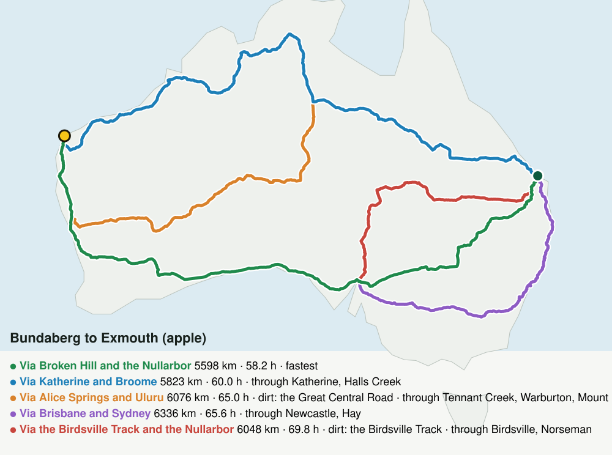

- **Via Broken Hill and the Nullarbor** 5598 km, 58.2 h (fastest)
- **Via Katherine and Broome** 5823 km, 60 h, through Katherine, Halls Creek
- **Via Alice Springs and Uluru** 6076 km, 65 h, dirt: the Great Central Road, through Tennant Creek, Warburton, Mount Magnet
- **Via Brisbane and Sydney** 6336 km, 65.6 h, through Newcastle, Hay
- **Via the Birdsville Track and the Nullarbor** 6048 km, 69.8 h, dirt: the Birdsville Track, through Birdsville, Norseman

Tried

- way Katherine · Halls Creek: added (5823 km)
- way Moree: same roads as the fastest
- way Tennant Creek · Warburton · Mount Magnet: added (6076 km)
- way Newcastle · Hay: added (6336 km)
- way Birdsville · Norseman: added (6048 km)
- way Yunta · Leonora · Newman: same roads as the fastest

### Exmouth to Bundaberg  (9 s, 20 requests)

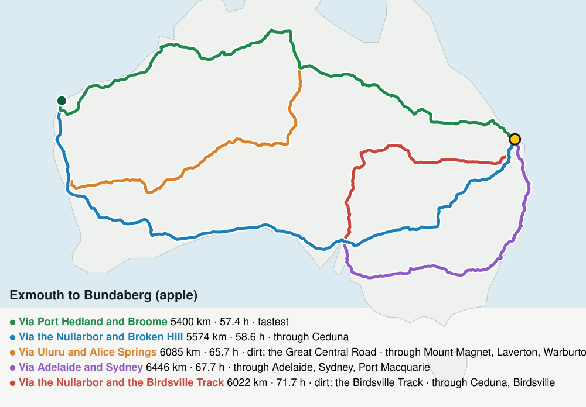

- **Via Port Hedland and Broome** 5400 km, 57.4 h (fastest)
- **Via the Nullarbor and Broken Hill** 5574 km, 58.6 h, through Ceduna
- **Via Uluru and Alice Springs** 6085 km, 65.7 h, dirt: the Great Central Road, through Mount Magnet, Laverton, Warburton, Tennant Creek
- **Via Adelaide and Sydney** 6446 km, 67.7 h, through Adelaide, Sydney, Port Macquarie
- **Via the Nullarbor and the Birdsville Track** 6022 km, 71.7 h, dirt: the Birdsville Track, through Ceduna, Birdsville

Tried

- way Halls Creek · Kununurra: same roads as the fastest
- way Ceduna: added (5574 km)
- way Mount Magnet · Laverton · Warburton · Tennant Creek: added (6085 km)
- way Adelaide · Sydney · Port Macquarie: added (6446 km)
- way Ceduna · Birdsville: added (6022 km)
- way Newman · Leonora · Ceduna: same roads as Ceduna

### Brisbane to Perth  (48 s, 13 requests)

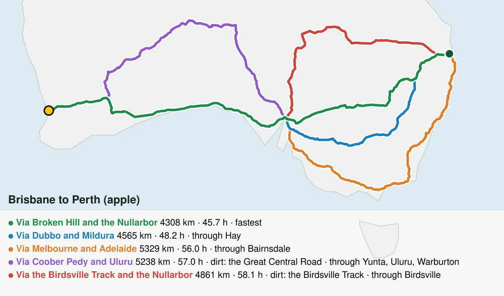

- **Via Broken Hill and the Nullarbor** 4308 km, 45.7 h (fastest)
- **Via Dubbo and Mildura** 4565 km, 48.2 h, through Hay
- **Via Melbourne and Adelaide** 5329 km, 56 h, through Bairnsdale
- **Via Coober Pedy and Uluru** 5238 km, 57 h, dirt: the Great Central Road, through Yunta, Uluru, Warburton
- **Via the Birdsville Track and the Nullarbor** 4861 km, 58.1 h, dirt: the Birdsville Track, through Birdsville

Tried

- way Bourke: same roads as the fastest
- way Bairnsdale: added (5329 km)
- way Birdsville: added (4861 km)
- way Yunta · Uluru · Warburton: added (5238 km)
- way Hay: added (4565 km)

### Cairns to Perth  (8 s, 18 requests)

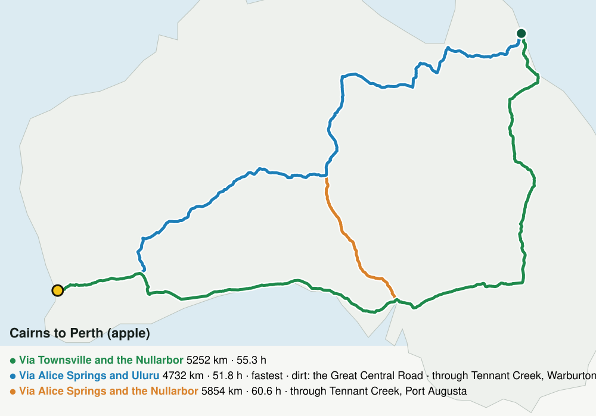

- **Via Townsville and the Nullarbor** 5252 km, 55.3 h
- **Via Alice Springs and Uluru** 4732 km, 51.8 h (fastest), dirt: the Great Central Road, through Tennant Creek, Warburton
- **Via Alice Springs and the Nullarbor** 5854 km, 60.6 h, through Tennant Creek, Port Augusta

Tried

- way Winton · Cobar: same roads as the fastest
- way Normanton · Burketown · Borroloola · Kununurra · Halls Creek: the long way round to Borroloola (1128 km)
- way Tennant Creek · Warburton: added (4732 km)
- way Tennant Creek · Port Augusta: added (5854 km)
- way Rockhampton · Yunta: same roads as the fastest
- way Dubbo: same roads as the fastest

### Melbourne to Darwin  (9 s, 18 requests)

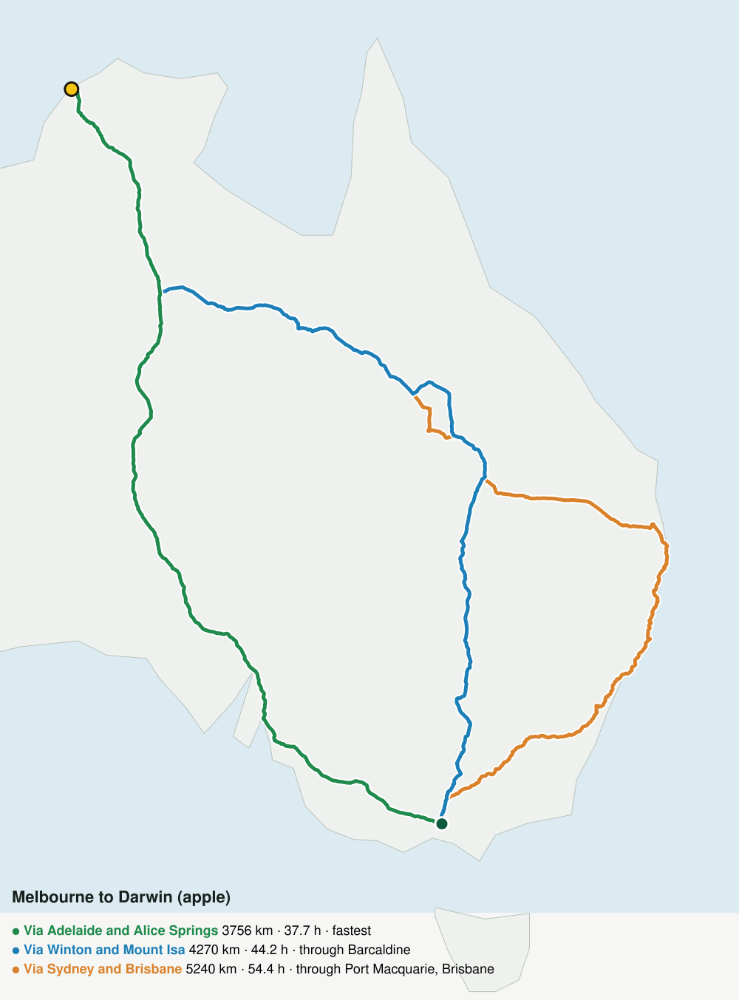

- **Via Adelaide and Alice Springs** 3756 km, 37.7 h (fastest)
- **Via Winton and Mount Isa** 4270 km, 44.2 h, through Barcaldine
- **Via Sydney and Brisbane** 5240 km, 54.4 h, through Port Macquarie, Brisbane

Tried

- way Barcaldine: added (4270 km)
- way Port Augusta · Birdsville · Boulia: the long way round to Boulia (1235 km)
- way Emerald · Charters Towers: same roads as Barcaldine
- way Port Macquarie · Brisbane: added (5240 km)
- way Rockhampton · Townsville: too long (5215 km, x1.39 distance, x1.45 time)
- town Streaky Bay: same roads as the fastest

### Sydney to Darwin  (48 s, 12 requests)

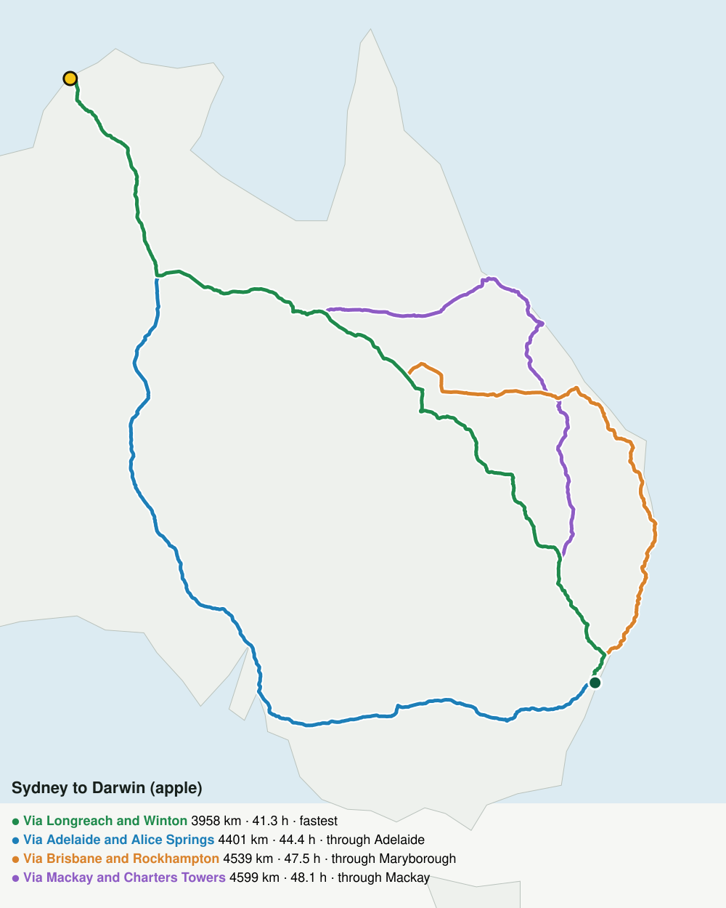

- **Via Longreach and Winton** 3958 km, 41.3 h (fastest)
- **Via Adelaide and Alice Springs** 4401 km, 44.4 h, through Adelaide
- **Via Brisbane and Rockhampton** 4539 km, 47.5 h, through Maryborough
- **Via Mackay and Charters Towers** 4599 km, 48.1 h, through Mackay

Tried

- way Bourke: same roads as the fastest
- way Adelaide: added (4401 km)
- way Mackay: added (4599 km)
- way Port Augusta · Birdsville · Boulia: the long way round to Boulia (1235 km)
- way Maryborough: added (4539 km)
- way Emerald: same roads as the fastest

### Bundaberg to Broome  (4 s, 11 requests)

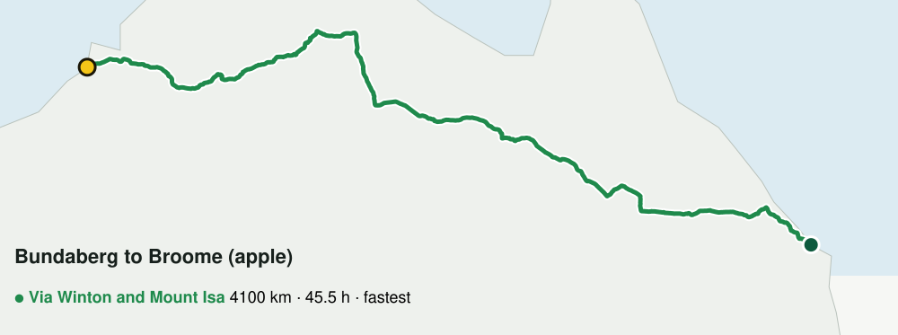

- **Via Winton and Mount Isa** 4100 km, 45.5 h (fastest)

Tried

- way Kununurra · Halls Creek: same roads as the fastest
- way Port Augusta · Katherine · Halls Creek: too long (6058 km, x1.48 distance, x1.36 time)
- way Birdsville · Katherine · Halls Creek: too long (5829 km, x1.42 distance, x1.39 time)
- way Tennant Creek · Alice Springs · the Tanami: the long way round to the Tanami (1742 km)
- town Bedourie: goes out and back (7% twice)

### Adelaide to Darwin  (2 s, 3 requests)

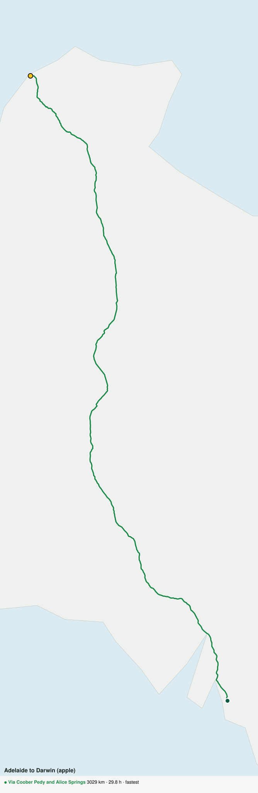

- **Via Coober Pedy and Alice Springs** 3029 km, 29.8 h (fastest)

Tried

- way Barcaldine: too long (4417 km, x1.46 distance, x1.53 time)
- way Marree · Boulia: the long way round to Boulia (2285 km)

### Brisbane to Sydney  (18 s, 17 requests)

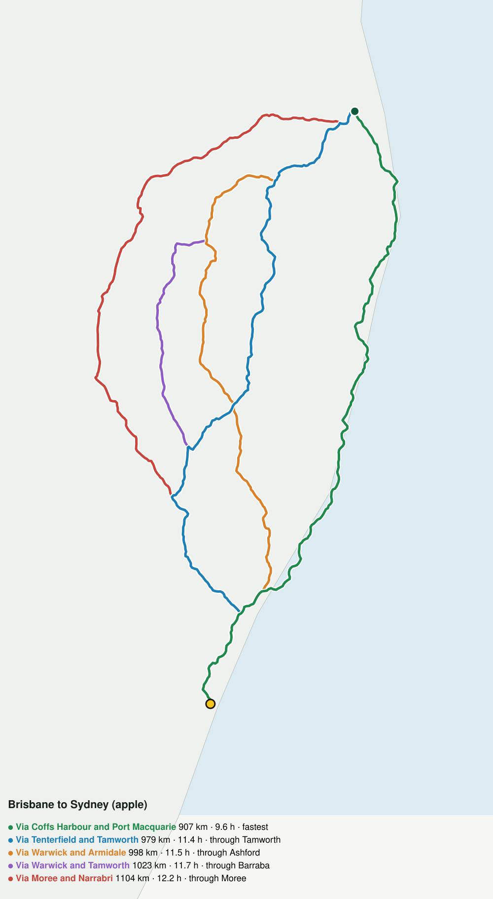

- **Via Coffs Harbour and Port Macquarie** 907 km, 9.6 h (fastest)
- **Via Tenterfield and Tamworth** 979 km, 11.4 h, through Tamworth
- **Via Warwick and Armidale** 998 km, 11.5 h, through Ashford
- **Via Warwick and Tamworth** 1023 km, 11.7 h, through Barraba
- **Via Moree and Narrabri** 1104 km, 12.2 h, through Moree

Tried

- way Moree: added (1104 km)
- way Tamworth: added (979 km)
- town Gloucester: same roads as the fastest
- town Uralla: same roads as Tamworth
- town Glen Innes: same roads as Tamworth
- town Nundle: same roads as Tamworth
- town Barraba: added (1023 km)
- town Ashford: added (998 km)

### Bundaberg to Melbourne  (9 s, 14 requests)

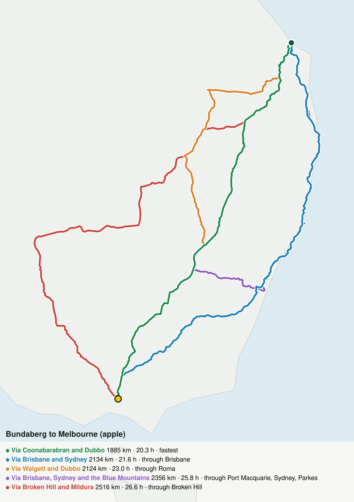

- **Via Coonabarabran and Dubbo** 1885 km, 20.3 h (fastest)
- **Via Brisbane and Sydney** 2134 km, 21.6 h, through Brisbane
- **Via Walgett and Dubbo** 2124 km, 23 h, through Roma
- **Via Brisbane, Sydney and the Blue Mountains** 2356 km, 25.8 h, through Port Macquarie, Sydney, Parkes
- **Via Broken Hill and Mildura** 2516 km, 26.6 h, through Broken Hill

Tried

- way Brisbane: added (2134 km)
- way Port Macquarie: same roads as Brisbane
- way Barcaldine: too long (2708 km, x1.44 distance, x1.41 time)
- way Roma: added (2124 km)
- way Broken Hill: added (2516 km)
- way Port Macquarie · Sydney · Parkes: added (2356 km)

### Melbourne to Adelaide  (53 s, 13 requests)

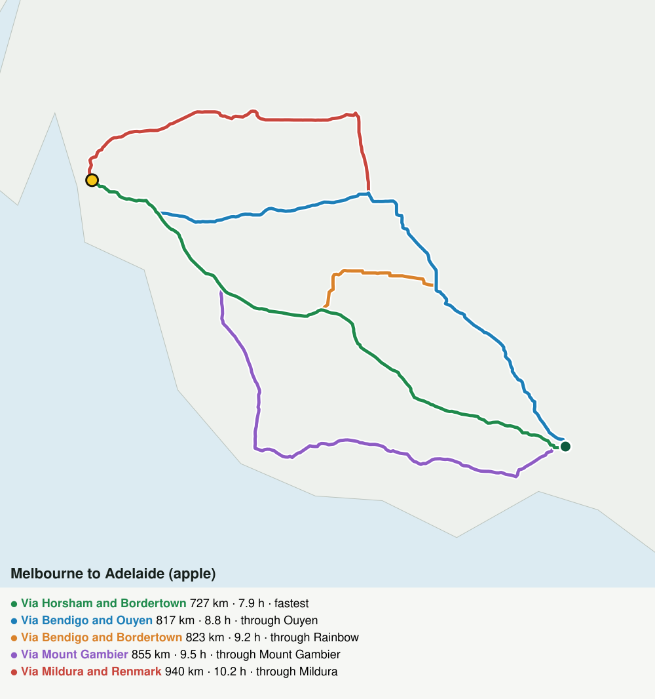

- **Via Horsham and Bordertown** 727 km, 7.9 h (fastest)
- **Via Bendigo and Ouyen** 817 km, 8.8 h, through Ouyen
- **Via Bendigo and Bordertown** 823 km, 9.2 h, through Rainbow
- **Via Mount Gambier** 855 km, 9.5 h, through Mount Gambier
- **Via Mildura and Renmark** 940 km, 10.2 h, through Mildura

Tried

- way Mildura: added (940 km)
- way Mount Gambier: added (855 km)
- way Ouyen: added (817 km)
- town Rainbow: added (823 km)
- town St Arnaud: same roads as Rainbow

### Perth to Darwin  (4 s, 11 requests)

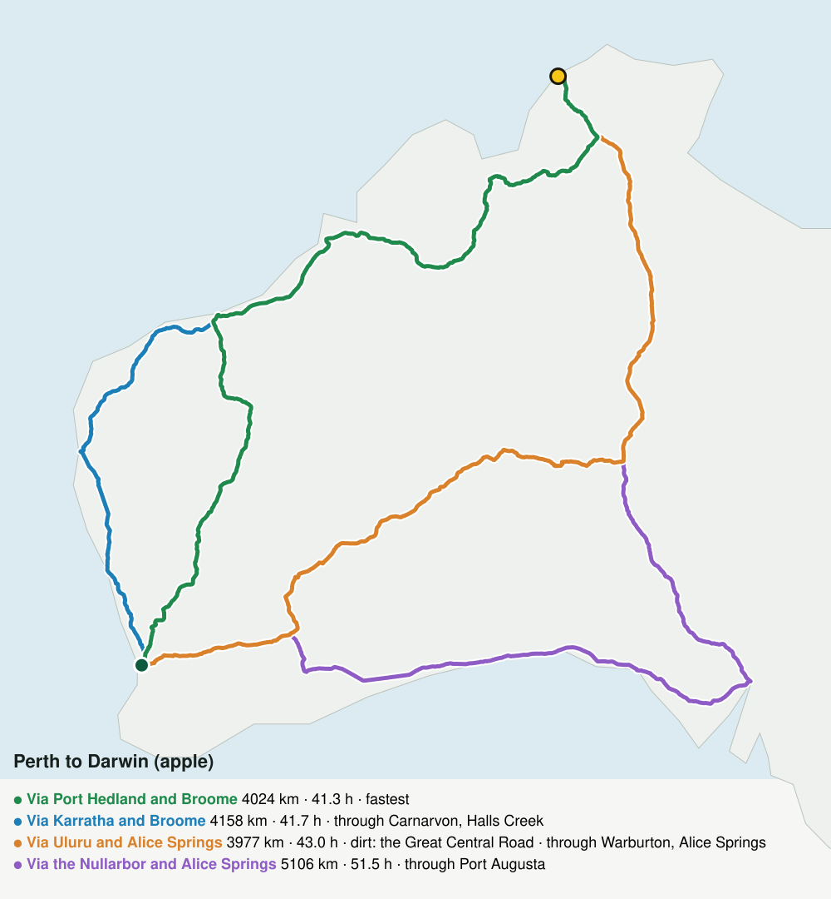

- **Via Port Hedland and Broome** 4024 km, 41.3 h (fastest)
- **Via Karratha and Broome** 4158 km, 41.7 h, through Carnarvon, Halls Creek
- **Via Uluru and Alice Springs** 3977 km, 43 h, dirt: the Great Central Road, through Warburton, Alice Springs
- **Via the Nullarbor and Alice Springs** 5106 km, 51.5 h, through Port Augusta

Tried

- way Port Augusta: added (5106 km)
- way Carnarvon · Halls Creek: added (4158 km)
- way Warburton · Alice Springs: added (3977 km)
- way the Gibb River Road: the long way round to Darwin (1855 km)

### Townsville to Alice Springs  (2 s, 7 requests)

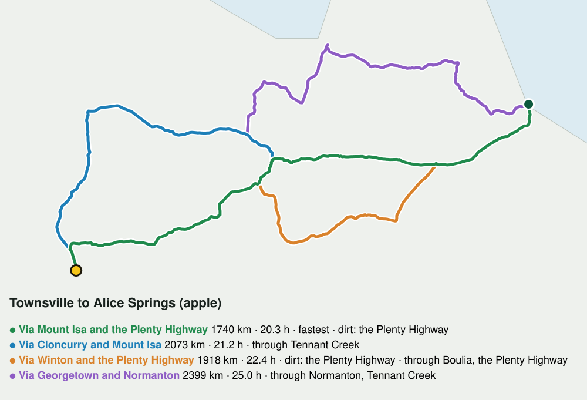

- **Via Mount Isa and the Plenty Highway** 1740 km, 20.3 h (fastest), dirt: the Plenty Highway
- **Via Cloncurry and Mount Isa** 2073 km, 21.2 h, through Tennant Creek
- **Via Winton and the Plenty Highway** 1918 km, 22.4 h, dirt: the Plenty Highway, through Boulia, the Plenty Highway
- **Via Georgetown and Normanton** 2399 km, 25 h, through Normanton, Tennant Creek

Tried

- way Tennant Creek: added (2073 km)
- way Boulia · the Plenty Highway: added (1918 km)
- way Normanton · Tennant Creek: added (2399 km)

### Sydney to Perth  (6 s, 7 requests)

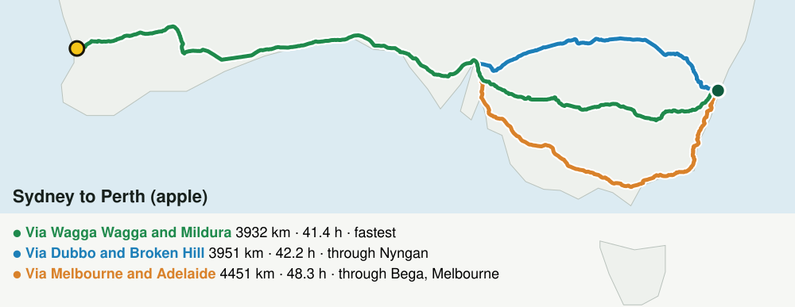

- **Via Wagga Wagga and Mildura** 3932 km, 41.4 h (fastest)
- **Via Dubbo and Broken Hill** 3951 km, 42.2 h, through Nyngan
- **Via Melbourne and Adelaide** 4451 km, 48.3 h, through Bega, Melbourne

Tried

- way Nyngan: added (3951 km)
- way Adelaide: same roads as the fastest
- way Bega · Melbourne: added (4451 km)

## Valhalla (website)

### Brisbane to Sydney  (10 s, 9 requests)

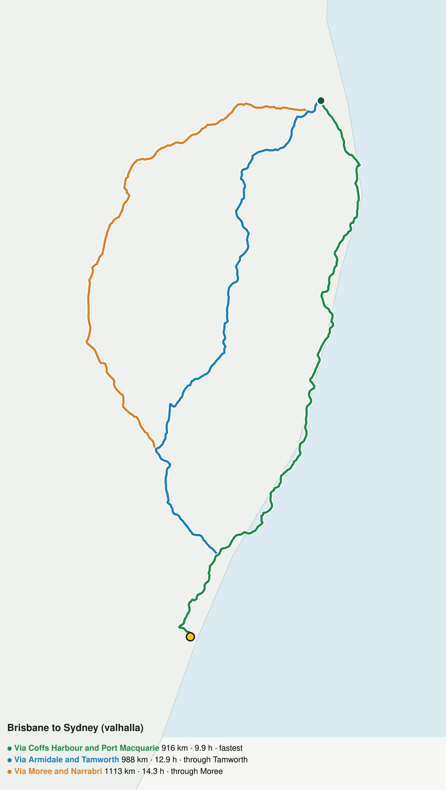

- **Via Coffs Harbour and Port Macquarie** 916 km, 9.9 h (fastest)
- **Via Armidale and Tamworth** 988 km, 12.9 h, through Tamworth
- **Via Moree and Narrabri** 1113 km, 14.3 h, through Moree

Tried

- way Moree: added (1113 km)
- way Tamworth: added (988 km)
- town Gloucester: same roads as the fastest
- town Uralla: same roads as Tamworth
- town Glen Innes: same roads as Tamworth
- town Barraba: same roads as Tamworth
- town Delungra: same roads as Tamworth
- town Carroll: same roads as Tamworth

### Bundaberg to Melbourne

Failed: Path distance exceeds the max distance limit: 1500000 meters

### Melbourne to Adelaide  (9 s, 7 requests)

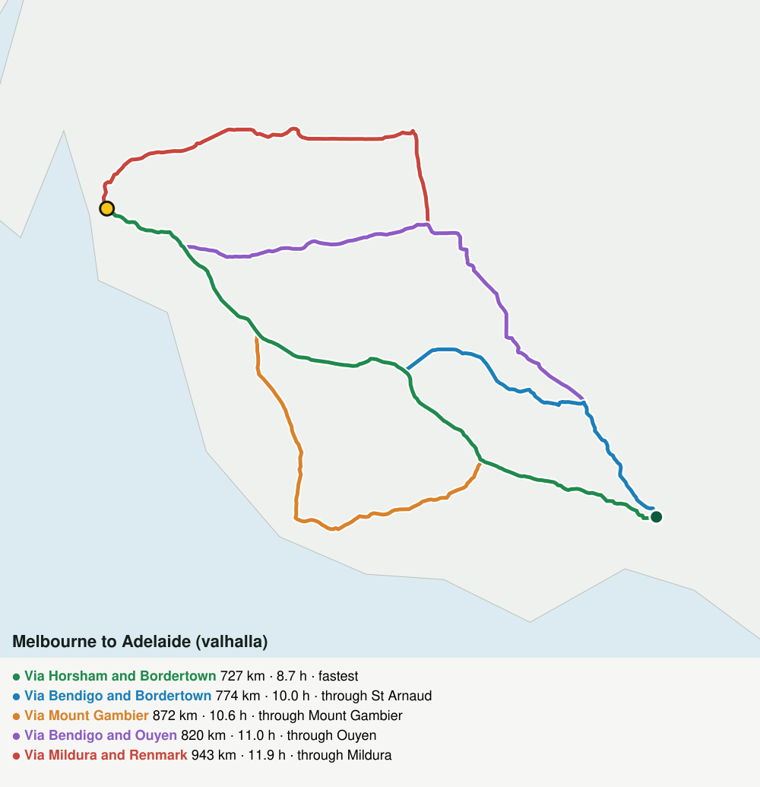

- **Via Horsham and Bordertown** 727 km, 8.7 h (fastest)
- **Via Bendigo and Bordertown** 774 km, 10 h, through St Arnaud
- **Via Mount Gambier** 872 km, 10.6 h, through Mount Gambier
- **Via Bendigo and Ouyen** 820 km, 11 h, through Ouyen
- **Via Mildura and Renmark** 943 km, 11.9 h, through Mildura

Tried

- way Mildura: added (943 km)
- way Mount Gambier: added (872 km)
- way Ouyen: added (820 km)
- town Rainbow: same roads as the fastest
- town St Arnaud: added (774 km)

### Townsville to Alice Springs  (5 s, 4 requests)

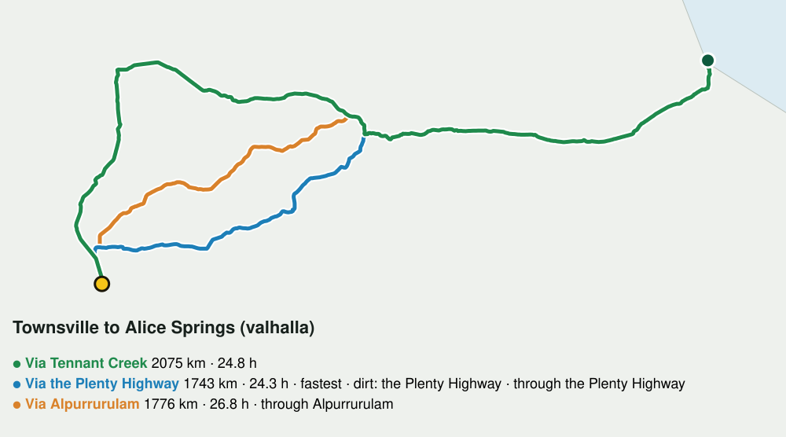

- **Via Tennant Creek** 2075 km, 24.8 h
- **Via the Plenty Highway** 1743 km, 24.3 h (fastest), dirt: the Plenty Highway, through the Plenty Highway
- **Via Alpurrurulam** 1776 km, 26.8 h, through Alpurrurulam

Tried

- way the Plenty Highway: added (1743 km)
- way Normanton · Tennant Creek: no route
- town Alpurrurulam: added (1776 km)

